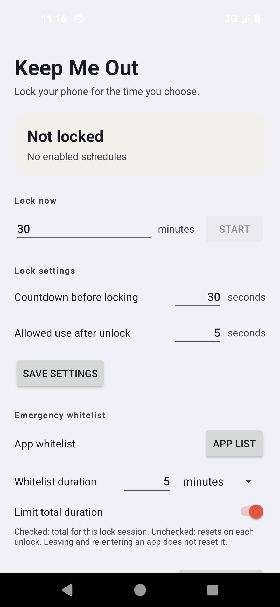
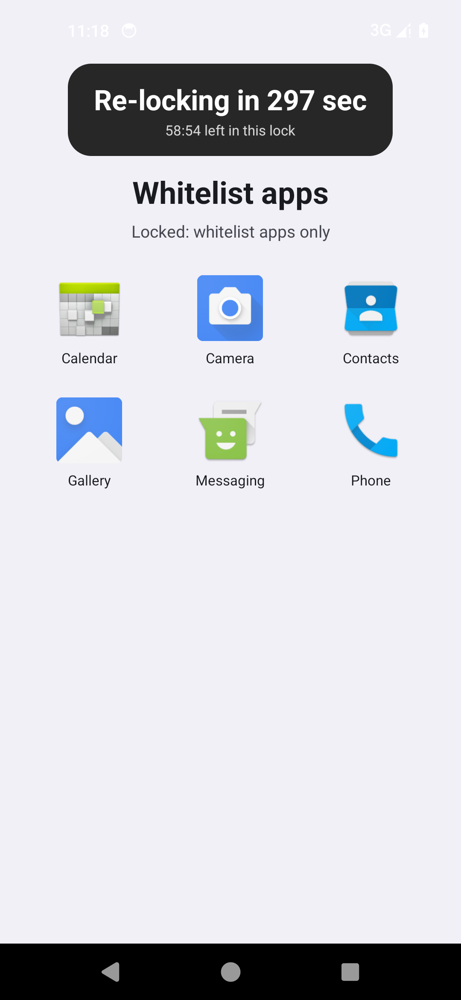
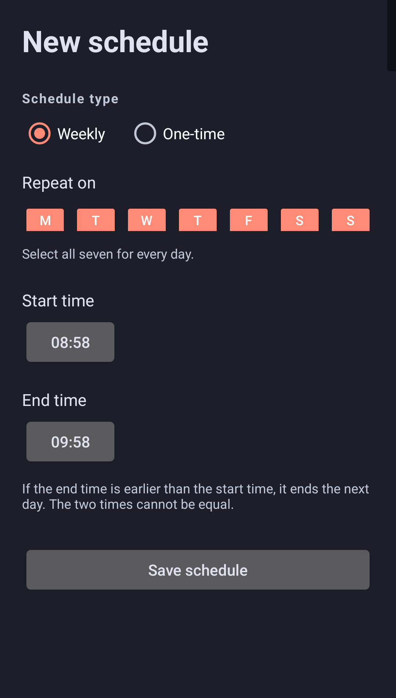

# Keep Me Out

**English** | [中文](README.zh-CN.md)

Keep Me Out is a small, personal Android app that helps you use your phone less by enforcing timed lock periods. It uses the real system lock screen, exact alarms, an accessibility countdown overlay, and an emergency whitelist page that shows only the apps you allow during a lock session.

| Main screen | Whitelist page | Schedule editor |
| --- | --- | --- |
|  |  |  |

## Features

- **Lock now** — choose a duration in minutes, show a configurable pre-lock countdown, then lock the phone for the full duration. The pre-lock countdown is not counted as lock time.
- **Scheduled locks** — weekly schedules (select Monday–Sunday; all seven means every day) or one-time schedules with a date and start/end time. If the end time is earlier than the start time, the window ends the next day. Multiple schedules can overlap.
- **Warning before scheduled locks** — a floating countdown starts `preLockSeconds` before the configured start, and the phone locks at the start time.
- **Unlock grace** — every unlock during an active lock gives `graceSeconds` of use, then the phone locks again. This repeats until the session ends.
- **Whitelist page** — after unlocking during a lock session, a page opens automatically and shows only the whitelisted apps. Tap an app to open it; leaving that app returns to the whitelist page and restarts the grace countdown. The page closes when the lock session ends.
- **Emergency whitelist** — choose the allowed apps with **App list** and set **Whitelist duration** in minutes or seconds. **Limit total duration** controls how the duration is spent:
  - **Off** — every **unlock** grants a fresh whitelist duration. Leaving and re-entering a whitelisted app during the same unlock continues the remaining time.
  - **On** — one cumulative duration for the entire lock session, across unlocks. Once it is used up, opening a whitelisted app locks the phone again until the session ends.
- **Countdown overlay** — a small pill at the top of the screen shows the remaining time. It is drawn as an accessibility overlay so it stays visible over the system phone/contacts app, which can hide ordinary overlays. If accessibility is not enabled, it falls back to a normal display-over-other-apps overlay.
- **Persistent notification** — shows the next lock, current countdown, or session status, and provides a **Whitelist apps** action during a session.
- **Cancel a warning** — before the lock starts, cancel that occurrence from the app or the notification.
- **One-time cleanup** — a one-time schedule is removed automatically after it finishes, or immediately when its only occurrence is cancelled or exited.
- **Language** — switch between Chinese and English in the app. The UI, date/day formats, notifications and overlay follow the choice and it is remembered.
- **No network access** — no INTERNET permission and no analytics.
- **Debug builds only** — the debug build also has a **Debug: exit this lock now** button. Release builds do not include it.

## Requirements

- Android 13 (API 33) or newer.
- A secure lock screen (PIN, pattern, or password). Swipe-only is not enough.
- Special access/permissions:
  - Notifications
  - Display over other apps (also used as the countdown fallback)
  - Accessibility service (recommended; used for locking, foreground-app detection and the countdown overlay. It reads only the foreground app package to enforce the whitelist; it does not read screen content.)
  - Device admin (optional fallback for locking; may require PIN/pattern/password)
  - Battery optimization whitelist (recommended)
- Exact alarms: the app declares `USE_EXACT_ALARM`, intended for personal sideloading. It is granted at install and is not user-revocable.

## Build

Requirements: JDK 17 and Android SDK 35.

```bash
./gradlew testDebugUnitTest assembleRelease
```

APK outputs:

```text
app/build/outputs/apk/release/app-release.apk
app/build/outputs/apk/debug/app-debug.apk
```

## Install

```bash
adb install -r app/build/outputs/apk/release/app-release.apk
```

Use the debug APK for development if you want the debug exit button. The package name is `com.me.keepmeout`.

## First-time setup

Open the app and complete the rows in **Setup**:

1. **Notifications** — allow notifications.
2. **Display over other apps** — used as the fallback for the floating countdown.
3. **Secure lock screen** — set a PIN, pattern, or password.
4. **Accessibility** — enable **Keep Me Out Screen Lock**. It identifies the foreground app package to enforce the whitelist; it does not read screen content. On Android 13+, if restricted settings appears, allow restricted settings from the app info menu first.
5. **Device admin** (optional fallback) — note that it can require a PIN/pattern/password on every unlock.
6. **Battery optimization** — add the app to the whitelist. On Xiaomi/Redmi, OPPO/OnePlus, vivo and similar devices, also allow autostart or background activity.
7. **Exact alarms** — normally available automatically; the app checks and reports any problem.
8. **Emergency whitelist** — choose the apps, set the duration, and decide whether to limit the total duration. On some OEM ROMs also allow **background pop-up** so the whitelist page can reopen reliably.

For the first test, use short values: pre-lock **10 s**, grace **5 s**, and lock now **1 minute**.

## Usage

### Lock now

1. Enter the lock duration in minutes (for example, 29).
2. Optionally adjust **Countdown before locking**, **Allowed use after unlock**, and the emergency whitelist.
3. Tap **Start**.
4. The floating countdown appears. At zero, the real system lock screen is shown.
5. Each unlock grants the grace period and opens the whitelist page.
6. Tap a whitelisted app to use it. Leaving it returns to the whitelist page; the grace countdown continues and the phone locks again when it ends.
7. During a session, the notification's **Whitelist apps** action reopens the whitelist page.

### Emergency whitelist

- Tap **App list** next to **App whitelist** and select the apps allowed during a lock session.
- Set **Whitelist duration**. Use the unit selector to enter minutes or seconds.
- **Limit total duration**:
  - **Off** — the duration applies to each unlock. Re-entering an app within the same unlock continues from the remaining time; a new unlock starts again.
  - **On** — the duration is shared by the whole lock session and across unlocks. When it runs out, entering a whitelisted app locks the phone again.
- Whitelist apps and duration are frozen once a lock session starts.

### Scheduled locks

- Tap **Add schedule**.
- Choose **Weekly** and select days, or **One-time** and pick a date plus start/end times.
- If the end time is earlier than the start time, the window ends on the next day.
- A warning appears `preLockSeconds` before the start; the phone locks at the start time.
- During the warning, **Cancel this lock** skips that occurrence; the schedule remains.
- A one-time schedule is removed after its end, or immediately if its only occurrence is cancelled/exited.

### Language

Tap **Language** and choose **中文** or **English**. The choice is stored by Android's per-app language setting and also appears in system app-language settings.

## Behavior details

- Lock duration starts after the phone actually locks; the pre-lock warning is not included.
- During an active session, every unlock gets `graceSeconds`; turning the screen off pauses the grace/whitelist timer.
- The whitelist page opens after each unlock during an active session and lists only the whitelisted apps. Pressing Back on the page does nothing; Home still goes to the launcher, because the page is not a replacement launcher.
- Whitelist timing:
  - **Limit total duration off**: each unlock gives a fresh duration. Leaving and re-entering an app during the same unlock continues the remaining time.
  - **Limit total duration on**: one cumulative duration for the entire lock session. It continues across unlocks, and when it is exhausted, entering a whitelisted app locks the phone again.
- The countdown is drawn with `TYPE_ACCESSIBILITY_OVERLAY` when the accessibility service is connected, so it stays visible over apps that hide ordinary overlays. Without accessibility, the normal overlay is used and may be hidden by the phone/contacts app.
- The accessibility service only reads the foreground app package to enforce the whitelist; it does not read screen content.
- At the end time, the app stops re-locking but **cannot unlock the phone automatically**. Unlock it normally.
- Once locked, changing or deleting schedules/settings does not shorten the current session.
- One-time schedules are cleaned from both saved data and the task list.
- The status bar shows the system alarm icon because exact alarms use `setAlarmClock`.
- The service is a foreground service; exact alarms and a battery whitelist keep it reliable.

## Known limitations

- This is a personal self-control tool. It does not resist uninstalling the app, disabling permissions, or Force Stop.
- Device admin mode may require a PIN/pattern/password on each unlock and may disable fingerprint for that unlock.
- `USE_EXACT_ALARM` fits personal sideloading. Google Play restricts it to alarm clock/timer/calendar use cases; for Play distribution, switch to `SCHEDULE_EXACT_ALARM` with a user grant.
- OEM battery managers can kill background services. Whitelist the app and enable autostart.
- Some OEM ROMs (ColorOS/OriginOS/MIUI and similar) restrict background activity starts. Allow **background pop-up** for Keep Me Out so the whitelist page can reopen after leaving an app.
- The whitelist page is an entry page, not a kiosk. Pressing Home can still show the launcher.
- Special secure screens may hide even accessibility overlays.
- Changing the system clock can affect wall-clock schedules; the app reschedules on time/timezone changes.
- The app cannot auto-unlock the phone at session end.

## Project layout

```text
app/src/main/java/com/me/keepmeout/
  MainActivity.kt                 Main screen, permissions, lock now, whitelist settings, schedules, language
  WhitelistActivity.kt            App picker for the emergency whitelist
  WhitelistHomeActivity.kt        Whitelist-only page shown after unlock
  ScheduleEditActivity.kt         Weekly / one-time schedule editor
  data/AppPrefs.kt                Settings, schedules, session and suppression state
  data/Schedule.kt                Schedule model and JSON storage
  schedule/ScheduleCalculator.kt  Pure time-window calculation
  schedule/AlarmScheduler.kt      Exact warning/start/end alarms
  service/LockService.kt          Foreground service and lock/whitelist state machine
  service/LockAccessibilityService.kt  Lock action, foreground app detection, accessibility overlay
  admin/LockDeviceAdminReceiver.kt
  ui/OverlayController.kt         Fallback floating countdown
  ui/NotificationController.kt    Foreground notification and actions
```

## Tests

```bash
./gradlew testDebugUnitTest
```

Unit tests cover daily/weekly windows, overnight windows, one-time schedules, overlap, pre-lock boundaries, cancellation suppression, `enabledAt`, committed sessions, manual windows, and one-time cleanup.

## License

[MIT](LICENSE) © 2026 21emerald
