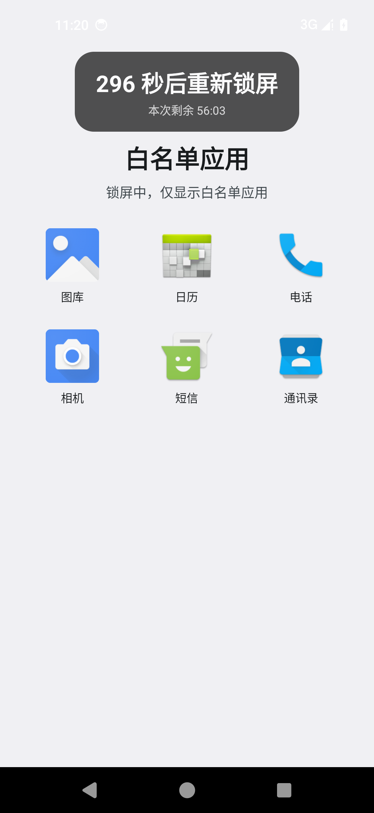

# Keep Me Out

[English](README.md) | **中文**

Keep Me Out 是一个个人自用的 Android 定时锁屏应用，用真实系统锁屏、精确闹钟、无障碍倒计时浮窗和紧急白名单页，帮你减少手机使用时间。锁屏期间解锁后会进入一个只显示白名单应用的白名单页。

| 主界面 | 白名单页 | 任务编辑 |
| --- | --- | --- |
|  |  |  |

## 功能

- **立即锁屏**：输入锁屏分钟数，先显示可配置的进入前倒计时，再完整锁定设定时长。倒计时不计入锁屏时长。
- **定时任务**：支持每周任务（选择周一至周日，全选即每天）和一次性任务（日期 + 开始/结束时间）。结束时间早于开始时间时表示次日结束；多个任务可以重叠。
- **定时任务开始前警告**：在开始时间前 `preLockSeconds` 秒显示浮窗倒计时，到开始时间准时锁屏。
- **解锁宽限**：锁屏期间每次解锁都会给出 `graceSeconds` 秒使用时间，然后再次锁屏；一直持续到本次锁屏结束。
- **白名单页**：锁屏期间解锁后自动打开，只显示白名单应用。点图标打开应用；从应用退出后会回到白名单页，并重新开始宽限倒计时。本次锁屏结束后页面自动关闭。
- **紧急白名单**：用 **应用列表** 选择允许的应用，用 **白名单时长** 设置时长（可选分钟/秒）。**限制总时长** 决定这份时长怎么用：
  - **不勾选**：每次**解锁**给一份完整白名单时长。同一次解锁内离开应用再进入，会继续使用剩余时间。
  - **勾选**：整个锁屏会话共用一份总时长，跨多次解锁累计。用完后再打开白名单应用会立即重新锁屏，直到本次会话结束。
- **倒计时浮窗**：屏幕顶部的小卡片显示剩余时间。它使用无障碍悬浮层绘制，所以即使系统的电话/联系人界面隐藏普通悬浮窗，仍然能看到倒计时。无障碍未启用时会退回普通“显示在其他应用上层”悬浮窗。
- **常驻通知**：显示下一次锁屏、当前倒计时或会话状态；锁屏会话中提供 **白名单应用** 操作，可随时回到白名单页。
- **取消警告**：正式锁屏前，可以在应用或通知里取消这一次锁屏。
- **一次性任务清理**：一次性任务结束后自动删除；如果它唯一的一次锁屏被取消或退出，也会立即删除。
- **语言**：应用内可切换中文 / English，界面、任务编辑的日期和星期格式、通知和浮窗都会切换并记住选择。
- **不联网**：没有 INTERNET 权限，也不收集统计信息。
- **仅调试版**：调试版额外提供 **调试：立即退出本次锁屏** 按钮；正式版不包含。

## 环境要求

- Android 13（API 33）或更高版本。
- 必须设置安全锁屏（PIN、图案或密码），仅滑动解锁不够。
- 需要以下权限/特殊访问：
  - 通知
  - 显示在其他应用上层（同时作为倒计时浮窗的兜底方案）
  - 无障碍服务（推荐；用于锁屏、识别前台应用和绘制倒计时浮窗。它只读取当前前台应用的包名来执行白名单，不读取屏幕内容。）
  - 设备管理器（可选兜底锁屏，可能要求每次输入 PIN/图案/密码）
  - 电池优化白名单（建议）
- 精确闹钟：应用声明了 `USE_EXACT_ALARM`，用于个人侧载，安装即授予且用户不能撤销。

## 构建

需要 JDK 17 和 Android SDK 35。

```bash
./gradlew testDebugUnitTest assembleRelease
```

APK 输出：

```text
app/build/outputs/apk/release/app-release.apk
app/build/outputs/apk/debug/app-debug.apk
```

## 安装

```bash
adb install -r app/build/outputs/apk/release/app-release.apk
```

开发调试需要“调试：立即退出本次锁屏”按钮时，安装 debug APK。包名：`com.me.keepmeout`。

## 首次设置

打开应用，完成 **使用前设置**：

1. **通知**：允许通知。
2. **悬浮窗**：允许“显示在其他应用上层”，作为倒计时浮窗的兜底。
3. **安全锁屏**：设置 PIN、图案或密码。
4. **无障碍**：启用 **Keep Me Out 锁屏**。它只识别当前前台应用的包名来执行白名单，不读取屏幕内容。Android 13+ 如果提示受限设置，先在应用详情页右上角允许受限设置。
5. **设备管理器**（可选兜底）：启用后系统可能要求每次解锁都输入 PIN/图案/密码。
6. **电池优化**：把应用加入白名单；小米/Redmi、OPPO/一加、vivo 等还需允许自启动或后台运行。
7. **精确闹钟**：正常情况下自动可用，应用会检查并提示异常。
8. **紧急白名单**：选择应用、设置时长，并决定是否限制总时长。部分厂商系统还需要允许 **后台弹出界面**，白名单页才能在退出应用后可靠地重新出现。

第一次测试建议用短参数：进入前倒计时 **10 秒**、宽限 **5 秒**、立即锁屏 **1 分钟**。

## 使用方法

### 立即锁屏

1. 输入锁屏时长（分钟），例如 29。
2. 按需调整“进入锁屏前倒计时”“解锁后允许使用”和紧急白名单。
3. 点 **开始**。
4. 顶部浮窗显示倒计时；到点后进入真实系统锁屏。
5. 每次解锁都会获得宽限时间，并自动打开白名单页。
6. 点白名单应用即可使用；从应用退出后回到白名单页，宽限倒计时继续，结束后再次锁屏。
7. 会话进行中，可以点通知里的 **白名单应用** 回到白名单页。

### 紧急白名单

- 在 **应用白名单** 右侧点 **应用列表**，勾选锁屏期间允许使用的应用。
- 设置 **白名单时长**，右侧单位可切换分钟 / 秒。
- **限制总时长**：
  - **不勾选**：时长按每次解锁计算。同一次解锁内离开应用再进入，会继续使用剩余时间；重新解锁后重新计时。
  - **勾选**：时长由整个锁屏会话共用，跨多次解锁累计。用完后再次打开白名单应用会直接重新锁屏。
- 锁屏会话开始后，白名单应用和时长会锁定，不能修改。

### 定时任务

- 点 **添加任务**。
- 选择 **每周** 并勾选星期，或选择 **一次性** 并设置日期和开始/结束时间。
- 结束时间早于开始时间时，表示次日结束。
- 开始前 `preLockSeconds` 秒显示警告，到开始时间准时锁屏。
- 警告阶段点 **取消本次锁屏** 只跳过这一次，任务本身保留。
- 一次性任务结束后自动删除；唯一的一次锁屏被取消或退出时也会立即删除。

### 语言

点 **语言** 选择 **中文** 或 **English**。选择由 Android 的应用级语言设置保存，也会出现在系统的应用语言设置中。

## 行为说明

- 锁屏时长从真正上锁后开始计算，进入前警告不计入。
- 活动会话里的每次解锁都会获得 `graceSeconds`；熄屏会暂停宽限/白名单计时。
- 锁屏期间每次解锁后都会打开白名单页，只显示白名单应用。白名单页上按返回键不会退出；按 Home 仍可回到桌面（它不是系统桌面替代品）。
- 白名单计时：
  - **不勾选“限制总时长”**：每次解锁给一份完整时长。同一次解锁内离开应用再进入，会接着剩余时间继续。
  - **勾选“限制总时长”**：整个锁屏会话共用一份总时长，跨多次解锁累计。用完后再次打开白名单应用会直接重新锁屏。
- 无障碍服务连接时，倒计时使用 `TYPE_ACCESSIBILITY_OVERLAY` 绘制，因此系统的电话/联系人等会隐藏普通悬浮窗的应用里也能看到。无障碍未启用时退回普通悬浮窗，可能被这些应用隐藏。
- 无障碍服务只读取前台应用包名来执行白名单，不读取屏幕内容。
- 结束时间到达后应用只停止重新锁屏，**不会自动解锁手机**，正常解锁即可。
- 正式上锁后，修改/删除任务或设置不会缩短当前会话。
- 一次性任务会同时从保存数据和任务列表中清理。
- 精确闹钟使用 `setAlarmClock`，所以状态栏会出现系统闹钟图标。
- 应用使用前台服务和精确闹钟；建议加入电池优化白名单。

## 已知限制

- 这是个人自律工具，不防卸载、停用权限或 Force Stop。
- 设备管理器模式可能每次解锁都要 PIN/图案/密码，指纹可能不可用。
- `USE_EXACT_ALARM` 适合个人侧载；Google Play 只允许闹钟/计时器/日历等核心场景。若上架 Play，应改为 `SCHEDULE_EXACT_ALARM` 并加入用户授权。
- 部分厂商的后台管理会杀掉服务，需要加入电池白名单并允许自启动。
- 部分厂商系统（ColorOS/OriginOS/MIUI 等）会限制后台拉起 Activity。请给 Keep Me Out 打开 **后台弹出界面**，否则退出白名单应用后白名单页可能不能可靠地重新出现。
- 白名单页是解锁后的入口页，不是 kiosk；按 Home 仍可回到桌面。
- 特殊的系统安全界面可能连无障碍悬浮层也会隐藏。
- 手动修改系统时间会影响墙钟任务；应用会监听时间/时区变化并重新调度。
- 应用无法在会话结束时自动解锁手机。

## 工程结构

```text
app/src/main/java/com/me/keepmeout/
  MainActivity.kt                 主界面、权限、立即锁屏、白名单设置、任务列表、语言
  WhitelistActivity.kt            紧急白名单应用选择器
  WhitelistHomeActivity.kt        解锁后只显示白名单应用的页面
  ScheduleEditActivity.kt         每周 / 一次性任务编辑
  data/AppPrefs.kt                设置、任务、会话、白名单和取消抑制状态
  data/Schedule.kt                任务模型和 JSON 存储
  schedule/ScheduleCalculator.kt  纯时间窗口计算
  schedule/AlarmScheduler.kt      警告/开始/结束精确闹钟
  service/LockService.kt          前台服务和锁屏/白名单状态机
  service/LockAccessibilityService.kt  锁屏动作、前台应用识别、无障碍悬浮层
  admin/LockDeviceAdminReceiver.kt
  ui/OverlayController.kt         兜底悬浮窗倒计时
  ui/NotificationController.kt    前台通知和操作
```

## 测试

```bash
./gradlew testDebugUnitTest
```

单元测试覆盖每天/指定星期、跨夜、一次性、重叠窗口、进入前警告边界、取消抑制、`enabledAt`、已提交会话、手动窗口和一次性任务清理。

## 许可证

[MIT](LICENSE) © 2026 21emerald
