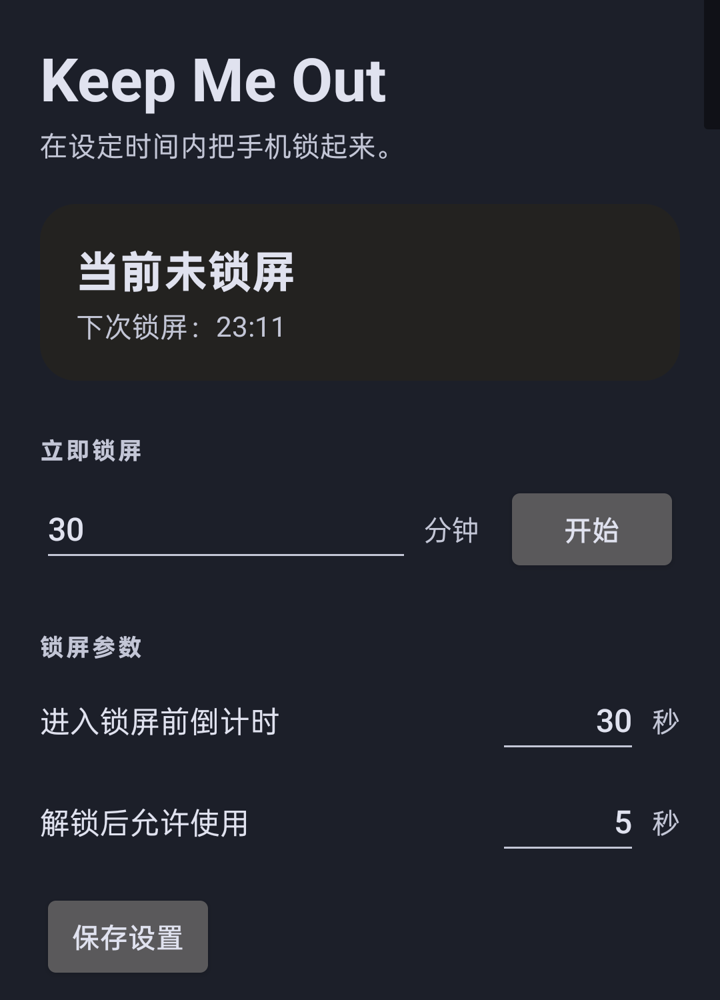
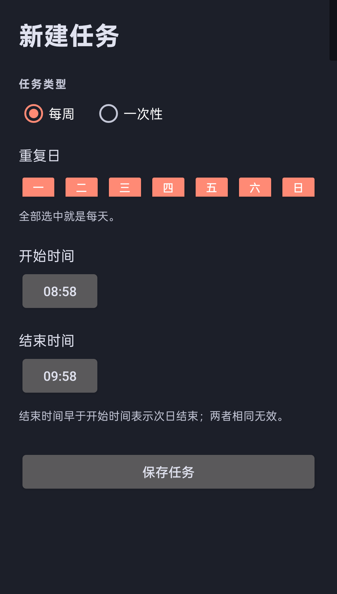

# Keep Me Out

[English](README.md) | **中文**

Keep Me Out 是一个个人自用的 Android 定时锁屏应用，用真实系统锁屏、精确闹钟和一个小巧的不阻挡操作的倒计时浮窗，帮你减少手机使用时间。

| 主界面 | 任务编辑 |
| --- | --- |
|  |  |

## 功能

- **立即锁屏**：输入锁屏分钟数，先显示可配置的进入前倒计时，再完整锁定设定时长。倒计时不计入锁屏时长。
- **定时任务**：支持每周任务（选择周一至周日，全选即每天）和一次性任务（日期 + 开始/结束时间）。结束时间早于开始时间时表示次日结束；多个任务可以重叠。
- **定时任务开始前警告**：在开始时间前 `preLockSeconds` 秒显示浮窗倒计时，到开始时间准时锁屏。
- **宽限期**：锁屏期间每次解锁都会给出 `graceSeconds` 秒使用时间，然后再次锁屏；一直持续到本次锁屏结束。
- **顶部浮窗**：屏幕顶部的小倒计时卡片，不获取焦点、不拦截触摸。
- **常驻通知**：显示下一次锁屏、当前倒计时或锁屏状态。
- **取消警告**：正式锁屏前，可以在应用或通知里取消这一次锁屏。
- **退出本次锁屏**：锁屏期间解锁并打开应用，点 **退出本次锁屏** 可停止本次的再次锁屏；定时任务仍然保留。
- **一次性任务清理**：一次性任务结束后自动删除；如果它唯一的一次锁屏被取消或退出，也会立即删除。
- **语言**：应用内可切换中文 / English，界面、任务编辑的日期和星期格式、通知和浮窗都会切换并记住选择。
- **不联网**：没有 INTERNET 权限，也不收集统计信息。

## 环境要求

- Android 13（API 33）或更高版本。
- 必须设置安全锁屏（PIN、图案或密码），仅滑动解锁不够。
- 需要以下权限/特殊访问：
  - 通知
  - 显示在其他应用上层（悬浮窗）
  - 无障碍服务（推荐，保留指纹解锁）
  - 设备管理器（可选兜底，可能要求每次输入 PIN/图案/密码）
  - 电池优化白名单（建议）
- 精确闹钟：应用声明了 `USE_EXACT_ALARM`，用于个人侧载，安装即授予且用户不能撤销。

## 构建

需要 JDK 17 和 Android SDK 35。

```bash
./gradlew testDebugUnitTest assembleDebug
```

APK 输出：

```text
app/build/outputs/apk/debug/app-debug.apk
```

## 安装

```bash
adb install -r app/build/outputs/apk/debug/app-debug.apk
```

包名：`com.me.keepmeout`。

## 首次设置

打开应用，完成 **使用前设置**：

1. **通知**：允许通知。
2. **悬浮窗**：允许“显示在其他应用上层”，否则没有顶部倒计时浮窗。
3. **安全锁屏**：设置 PIN、图案或密码。
4. **无障碍**：启用 **Keep Me Out 锁屏**。Android 13+ 如果提示受限设置，先在应用详情页右上角允许受限设置。
5. **设备管理器**（可选兜底）：启用后系统可能要求每次解锁都输入 PIN/图案/密码。
6. **电池优化**：把应用加入白名单；小米/Redmi、OPPO/一加、vivo 等还需允许自启动或后台运行。
7. **精确闹钟**：正常情况下自动可用，应用会检查并提示异常。

第一次测试建议用短参数：进入前倒计时 **10 秒**、宽限 **5 秒**、立即锁屏 **1 分钟**。

## 使用方法

### 立即锁屏

1. 输入锁屏时长（分钟），例如 29。
2. 按需调整“进入锁屏前倒计时”和“解锁后允许使用”。
3. 点 **开始**。
4. 顶部浮窗显示倒计时；到点后进入真实系统锁屏。
5. 每次解锁都会获得宽限时间，然后自动重新锁屏。
6. 宽限期间打开应用，点 **退出本次锁屏** 可以结束当前这一次锁屏。

### 定时任务

- 点 **添加任务**。
- 选择 **每周** 并勾选星期，或选择 **一次性** 并设置日期和开始/结束时间。
- 结束时间早于开始时间时，表示次日结束。
- 开始前 `preLockSeconds` 秒显示警告，到开始时间准时锁屏。
- 警告阶段点 **取消本次锁屏** 只跳过这一次，任务本身保留。
- 一次性任务结束后自动删除；唯一的一次锁屏被取消或退出时也会立即删除。

### 语言

点 **语言** 选择 **中文** 或 **English**。选择由 Android 的应用级语言设置保存，也会出现在系统的应用语言设置中。

## 行为说明

- 锁屏时长从真正上锁后开始计算，进入前警告不计入。
- 活动会话里的每次解锁都会获得 `graceSeconds`；熄屏会暂停宽限计时。
- 结束时间到达后应用只停止重新锁屏，**不会自动解锁手机**，正常解锁即可。
- 正式上锁后，修改/删除任务或设置不会缩短当前会话。
- 一次性任务会同时从保存数据和任务列表中清理。
- 精确闹钟使用 `setAlarmClock`，所以状态栏会出现系统闹钟图标。
- 应用使用前台服务和精确闹钟；建议加入电池优化白名单。

## 已知限制

- 这是个人自律工具，不防卸载、停用权限或 Force Stop。
- 设备管理器模式可能每次解锁都要 PIN/图案/密码，指纹可能不可用。
- `USE_EXACT_ALARM` 适合个人侧载；Google Play 只允许闹钟/计时器/日历等核心场景。若上架 Play，应改为 `SCHEDULE_EXACT_ALARM` 并加入用户授权。
- 部分厂商的后台管理会杀掉服务，需要加入电池白名单并允许自启动。
- 手动修改系统时间会影响墙钟任务；应用会监听时间/时区变化并重新调度。
- 应用无法在会话结束时自动解锁手机。

## 工程结构

```text
app/src/main/java/com/me/keepmeout/
  MainActivity.kt                 主界面、权限、立即锁屏、任务列表、语言
  ScheduleEditActivity.kt         每周 / 一次性任务编辑
  data/AppPrefs.kt                设置、任务、会话、取消抑制状态
  data/Schedule.kt                任务模型和 JSON 存储
  schedule/ScheduleCalculator.kt  纯时间窗口计算
  schedule/AlarmScheduler.kt      警告/开始/结束精确闹钟
  service/LockService.kt          前台服务和锁屏状态机
  service/LockAccessibilityService.kt
  admin/LockDeviceAdminReceiver.kt
  ui/OverlayController.kt         顶部浮窗倒计时
  ui/NotificationController.kt    前台通知
```

## 测试

```bash
./gradlew testDebugUnitTest
```

单元测试覆盖每天/指定星期、跨夜、一次性、重叠窗口、进入前警告边界、取消抑制、`enabledAt`、已提交会话、手动窗口和一次性任务清理。

## 许可证

[MIT](LICENSE) © 2026 21emerald
